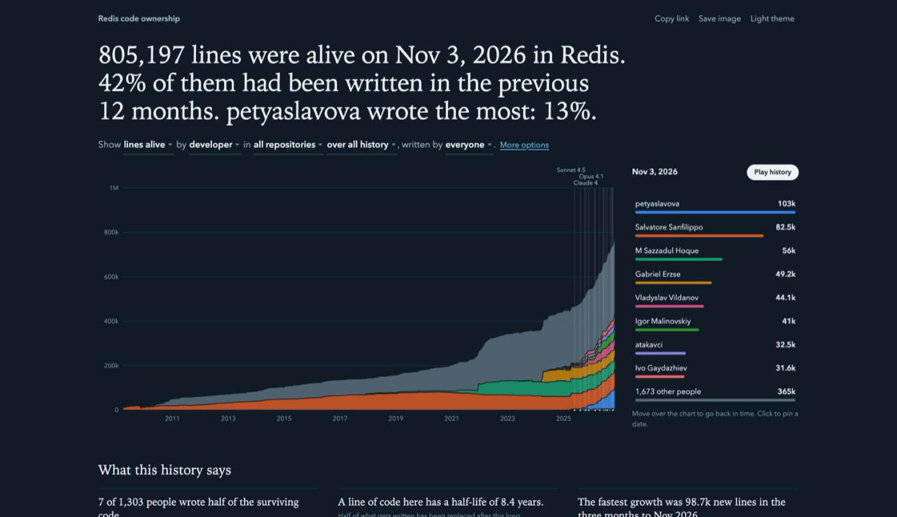

# git-planks

**Who owns the code that is still alive, across your whole stack?**

If every plank of a ship gets replaced, is it still the same ship? `git-planks` asks the same of your code: for each point of your history, it counts the lines still in place and who wrote them. It reads one repository or a whole GitHub, GitLab or Bitbucket organization, and writes one interactive page you can open anywhere.

**[Open the live demo on the Redis stack](https://zepgram.github.io/git-planks/)** (the server and three of its clients) and press *Play history*.

[](https://zepgram.github.io/git-planks/)

```sh
git-planks analyze github:your-org --open
```

## Why

[git-of-theseus](https://github.com/erikbern/git-of-theseus) by Erik Bernhardsson made this kind of chart famous, and git-planks reuses its method. git-planks exists for what comes next: a team rarely has one repository anymore, and code is now written at a pace that makes the question worth asking every month.

| | git-of-theseus | git-planks |
|---|---|---|
| Install | Python, with matplotlib | one binary, only `git` needed |
| Scope | one repository per run | whole organizations, groups, lists, submodules, grouped into scopes |
| Output | static plots | one interactive HTML file, works offline |
| Same author, several emails | write a `.mailmap` | merged automatically and listed for review, `.mailmap` honored |
| Bots and AI agents | counted as people | separated, can be filtered out |
| Lockfiles, vendored and generated code | filtered by file type, `--ignore` for the rest | excluded by default, per ecosystem |
| Reproducibility | not a stated goal | byte-identical replay with `git-planks verify` |
| Bulk imports | credited to whoever ran them | can be moved to an "unattributed" series |

git-of-theseus covers things git-planks does not: per-commit Kaplan-Meier survival and exponential fits.

## Install

Download a binary for macOS (Apple Silicon only), Linux or Windows from the [releases](https://github.com/zepgram/git-planks/releases), or build it with Rust 1.88 or later:

```sh
cargo install --git https://github.com/zepgram/git-planks
```

`git` must be on your `PATH`. The Windows build is tested in CI; macOS and Linux are the ones used daily. As the binary is named `git-planks`, `git planks analyze` works too.

## Use it

Point it at a remote or a folder. If `git clone` works with your SSH key, git-planks works: `git@host:org/repo.git`, an SSH alias such as `work:org/repo.git`, `ssh://` and `https://` addresses are all accepted.

```sh
git-planks analyze .                                  # the repository you are in
git-planks analyze git@bitbucket.org:acme/erp.git     # any remote, with your SSH key
git-planks analyze github:acme                        # every repository of an organization or user
git-planks analyze gitlab:acme/platform               # a group and its subgroups
git-planks analyze gitlab:https://git.acme.dev/platform --trust-host git.acme.dev   # self-hosted
git-planks analyze bitbucket:acme                     # a workspace
git-planks analyze @repos.txt                         # one address per line
git-planks analyze git@host:acme/root.git --submodules
git-planks analyze back=github:acme-api front=github:acme-web infra=gitlab:acme/ops   # one scope per group
```

`git-planks repos <sources>` shows what a source resolves to, without analyzing it. It clones nothing, unless `--submodules` needs to read a `.gitmodules`.

Listing an organization goes through its API: public ones need nothing. For private ones, set `GITHUB_TOKEN` (or be logged in with `gh`), `GITLAB_TOKEN` or `BITBUCKET_TOKEN`. Tokens are only used to list repositories, and only sent to github.com, gitlab.com, Bitbucket Cloud, or a self-hosted host you name with `--trust-host` on the command line, never to one named by a config file. Cloning uses your usual git access: SSH first when a token is set, HTTPS first otherwise, then the other one. Archived repositories and forks are skipped unless you name them.

A folder is analyzed at its checked-out `HEAD`, even detached, and needs its full history (a shallow clone is refused: in GitHub Actions, set `fetch-depth: 0`). A submodule is analyzed at the head of its own default branch, not at the commit its parent pins, and nested submodules are not followed.

## What you get

`planks-report/report.html` holds everything in one file, with no external request, so you can open it offline or attach it to a message.

- **A page that says what it sees.** The headline is computed from your data, and stays true for every filter and every date.
- **Filters you can read.** You complete a sentence: "Show lines alive by developer in all repositories over all history, written by everyone". Content and author types sit behind *More options*.
- **Time travel.** Move over the chart and the ranking beside it follows the date. Click to pin a date. *Play history* replays the life of the code while people overtake one another.
- **Findings you can act on**, each one a click away from the chart: how few people wrote half of the code, the half-life of a line, the fastest growth and the largest clean-up, the share of code whose authors have left.
- **AI model releases on the timeline**, from Anthropic, OpenAI, Google, xAI, DeepSeek, Mistral, Qwen, Kimi or GLM: pick one in the sentence above the chart ("…, with OpenAI releases"), or set the default with `--models openai` or `models = "openai"`. The period *since Claude 4* (or *since Codex*) starts at the first one. They give context, not a cause. The list ships in the binary: a weekly job proposes the new ones listed on [models.dev](https://models.dev), with `git-planks update-models`.
- **Monthly activity**, and **how long code lasts**, year by year.
- **Everyone who wrote the code**, searchable, with their own curve, change, commits, retention and last activity.
- **Links and images to share.** Every view has its own link, and *Save image* exports the chart as a PNG.

Next to the page, `manifest.json` pins what was analyzed, `data.json` holds the figures, and `identities.json` shows which git identities were merged. The report and `data.json` contain names but no email addresses. `manifest.json` holds your repository addresses and `[[person]]` entries, and `identities.json` holds addresses: read them before sharing.

## Trust the numbers

**They are reproducible.** The manifest records every commit, the configuration and the git version:

```sh
git-planks verify planks-report
```

This blames everything again without the cache, requires the same bytes for `report.html`, `data.json` and `identities.json`, and checks that the lines attributed to people equal the lines in the files. It takes as long as a first analysis; `--cached` is faster but does not check the cache. Commit a manifest and anyone with access can check the report, even after the branches moved on. A different version of git or of git-planks can legitimately change the result, and `verify` says so. Without `--until`, the cut-off is today, so two runs on different days differ by their last sample.

**You can see what they rest on.** A sudden jump is usually a vendored library, generated code or an import credited to whoever ran it:

```sh
git-planks audit planks-report
```

This lists the biggest jumps with the files behind them, and the largest counted files. Fix what you find in a `planks.toml`; [`examples/planks.toml`](examples/planks.toml) shows every option. Re-running after a config change is fast, since blame results are cached by commit and path.

## How it counts

1. Each repository is mirrored under `~/.cache/git-planks`. Your checkouts are never touched.
2. One commit per week is taken from the first-parent history of the branch the remote serves as `HEAD` (Monday 00:00 UTC, plus the cut-off day). `--interval-weeks 26` makes very large histories affordable.
3. Each file that changed since the previous sample goes through `git blame -w`, in parallel. A line belongs to the author of the commit that wrote it. Blame stops at the previous sample and lines already there keep the author found then, which gives the same result as a full blame; a full blame still runs when a merge brings in older history.
4. Files are kept when their extension is a known text format and they match no exclusion: lockfiles, `vendor/`, `dist/`, generated code and similar. Everything sorted, nothing timestamped, so the same input gives the same bytes.

## Limits

- **Very large histories are slow.** Blame runs on each changed file of each sample: at the rate we measured, the whole Linux kernel would take about a day per pass on a 14-core machine, even with one sample a year. Narrow a monorepo with `include`, or raise `--interval-weeks`.
- **Lines are not value.** Reviews, architecture, mentoring and deleting code barely show. Please do not rank people with this.
- A line reformatted beyond whitespace, or moved between files, changes author.
- A commit written with an AI assistant stays under the name of whoever pushed it, so the "Agents" series only counts commits made under an agent's own identity.
- A long-lived branch shows as a step on the day it lands, and an imported history appears on the day of the import, with its original authors.
- A squash merge credits its whole diff to one author.
- Blame is reused for a file whose content did not change between two samples, like git-of-theseus does: on rare merges, this can differ from a fresh blame of the last commit by a few lines. It stays stable from one run to the next.
- A file whose path is not valid UTF-8 is not counted. A text file that git treats as binary counts as surviving but not as added.
- Automatic identity merging can be wrong: two people sharing an address or a full name become one. `identities.json` lists every merge, and `[[person]]` overrides it.

## Built by an AI

This project was designed and written by [Claude Code](https://claude.com/claude-code), directed by [@zepgram](https://github.com/zepgram). [`skills/git-planks/SKILL.md`](skills/git-planks/SKILL.md) teaches your own coding agent to run an analysis and check it before quoting a figure.

Issues and pull requests are welcome. `cargo test` runs everything on throwaway repositories, with no network.

## License

MIT. git-planks shares no code with git-of-theseus (Apache-2.0) and owes it the idea.
